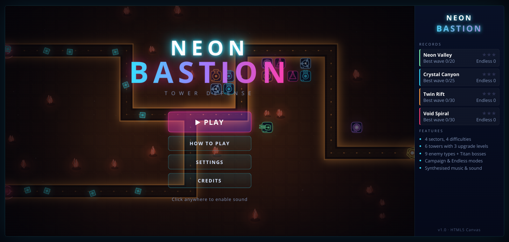
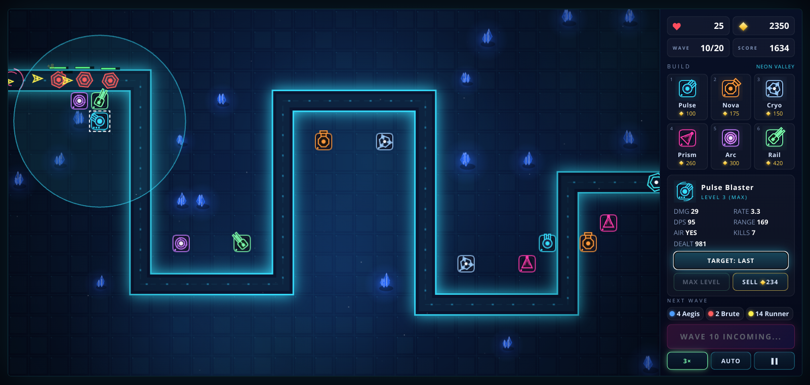
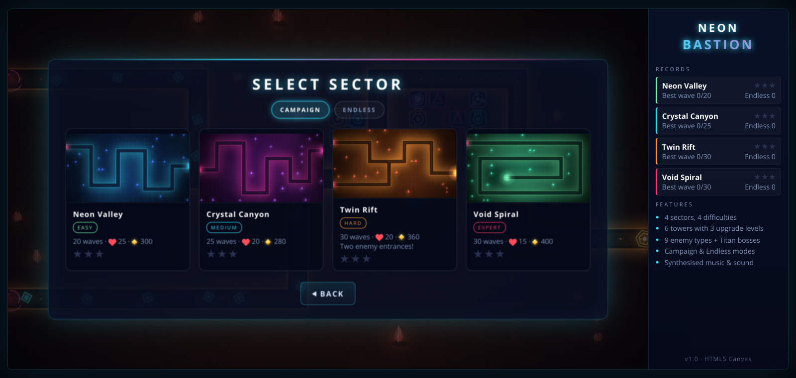

# Project 1: Neon Bastion (Tower Defense Game)

A neon sci‑fi **tower defense game** built from scratch with **HTML5 Canvas, CSS and plain JavaScript**.
It uses no game engine, no libraries, no image files and no sound files. Every tower, enemy, explosion, sound effect and music note is drawn or synthesised in code.





## How to run

1. Download or clone this repository.
2. Open `project-1-tower-defense/index.html` in any modern browser (Chrome, Edge, Firefox).

That's all. There is nothing to install and nothing to build.
(Optional: to serve it locally, run `python -m http.server` inside the folder and open http://localhost:8000.)

## Features

- **Full game flow**: animated main menu (with a live demo battle in the background), sector select, how‑to‑play, settings, credits, pause menu, victory and defeat screens.
- **4 maps (sectors)** with increasing difficulty: Easy, Medium, Hard (two enemy entrances) and Expert.
- **Campaign** (20–30 waves) and **Endless** mode, plus a star rating (1–3 ★) based on lives left.
- **6 towers**, each with 3 upgrade levels and 4 targeting modes (First / Last / Strongest / Closest):

  | Tower | Special |
  |---|---|
  | Pulse Blaster | Cheap, rapid fire |
  | Nova Cannon | Splash damage (ground only) |
  | Cryo Spire | Slows groups of enemies |
  | Prism Laser | Beam that heats up to 3× damage |
  | Arc Tesla | Chain lightning, ignores shields |
  | Rail Lancer | Huge range, pierces every enemy in a line, ignores armor |

- **9 enemy types**: fast runners, armored brutes, flying wraiths, shielded units, healers, splitters and the **Titan boss** every 10 waves.
- **Graphics**: glow and bloom effects, particles, lightning, laser beams, screen shake, animated paths and portals, and crisp rendering on high‑DPI screens. A LOW quality mode (switched on automatically when FPS drops) helps slower PCs.
- **Audio**: sound effects and adaptive music generated live with the Web Audio API.
- Game speed 1× / 2× / 3×, auto‑wave, early‑call bonus gold, keyboard shortcuts.
- Progress, records and settings are saved in the browser (localStorage).

## Controls

| Key / Mouse | Action |
|---|---|
| `1`–`6` or click the shop | Pick a tower, then click a free tile to build |
| `Shift` + click | Keep building the same tower |
| Click a tower | Select it |
| `U` / `S` / `T` | Upgrade / Sell / Change targeting |
| `Space` | Start wave / call next wave early (bonus gold) |
| `F` / `A` | Game speed / Auto‑wave |
| `P` or `Esc` | Pause |
| Right‑click | Cancel |

## Project structure

```
project-1-tower-defense/
├── index.html          # page layout: canvas, menus, sidebar HUD
├── css/style.css       # neon UI styling and animations
├── js/
│   ├── utils.js        # math helpers, seeded random, glow sprites
│   ├── data.js         # towers, enemies, maps, wave generator, save data
│   ├── audio.js        # synthesised sound effects and music (Web Audio API)
│   ├── particles.js    # particle system
│   ├── entities.js     # Enemy, Tower, Projectile classes and their drawing code
│   ├── game.js         # Game class: grid, waves, economy, update and render loop
│   ├── ui.js           # menus, HUD, shop, input handling
│   └── main.js         # boot, screen scaling, main loop
└── tests/simulate.js   # automated tests (see below)
```

## Testing

`tests/simulate.js` runs the real game code in Node.js, without a browser:

- **Unit tests**: building rules, gold costs, upgrades, selling refunds, armor, shields, splitting enemies, losing the game, and wave generation for every map.
- **AI balance simulation**: a bot plays every map from wave 1 to the end while the script checks that the game never reaches an invalid state (no NaN values, gold/lives always valid, no crashes).

```bash
node tests/simulate.js
```

The game was also tested end‑to‑end in headless Chrome: every menu, building, upgrading, selling, waves, pause, defeat, victory, Endless mode and all 4 maps.

## What I learned

- Game loop with fixed time steps, delta time and a speed multiplier
- Object‑oriented design (classes for towers, enemies, projectiles)
- 2D rendering with the Canvas API (additive blending, cached backgrounds, sprite glow)
- Targeting algorithms, splash and chain damage, point‑to‑line distance for piercing shots
- Procedural wave generation with a seeded random number generator
- Web Audio API synthesis, localStorage, responsive scaling

---
Made by **Shorya Pratap Singh Chandrawat**
